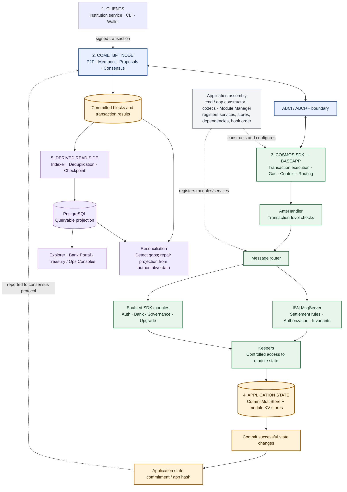
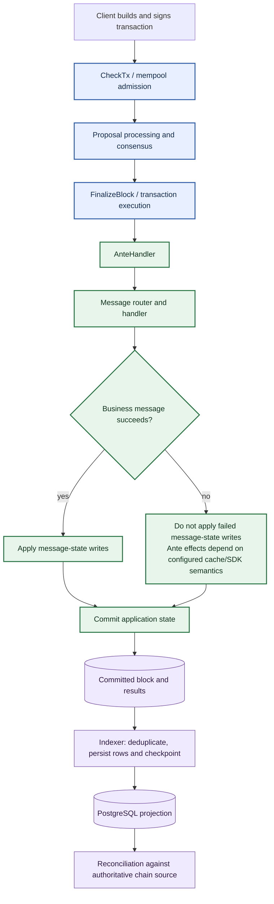
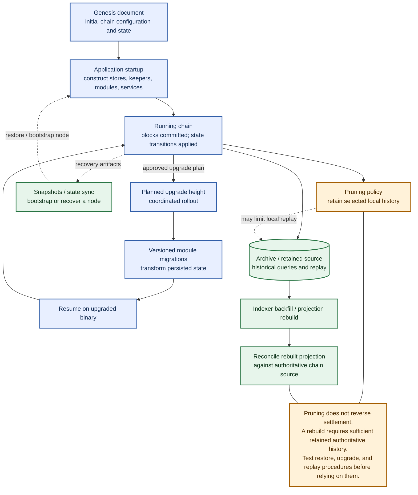

# Module 5 — Architecture diagrams

These diagrams are separated by question. GitHub renders the Mermaid blocks on this page; the editable `.mmd` sources are linked below each diagram.

## 1. Component architecture — who does what?

Follow the main path from client transaction to CometBFT, through ABCI into BaseApp and the module layer, then to committed state. The read side is separate: PostgreSQL and user interfaces are projections, not settlement authorities.

Source: [MODULE-05-cosmos-component-architecture.mmd](MODULE-05-cosmos-component-architecture.mmd)

## 2. Transaction lifecycle — what happens to one transaction?

This view focuses on admission, consensus, execution outcome, commit, indexing, and reconciliation. It does not try to explain genesis, upgrades, or node-retention policy.

Source: [MODULE-05-transaction-lifecycle-deep-dive.mmd](MODULE-05-transaction-lifecycle-deep-dive.mmd)

## 3. Chain operations lifecycle — how is the chain initialized, upgraded, and recovered?

This is an operator/lifecycle view, separate from both the component map and the transaction flow. It highlights the dependency between retained history and the ability to rebuild derived data.

Source: [MODULE-05-chain-operations-lifecycle.mmd](MODULE-05-chain-operations-lifecycle.mmd)

## Authority rules

- **Committed application state and committed chain records are authoritative** for settlement under the chosen chain design.
- **PostgreSQL, indexer checkpoints, and UI views are derived.** Detect discrepancies and repair/rebuild the projection from verified source data; do not alter chain balances to make SQL match.
- **CheckTx acceptance is not proof of settlement.** Admission, inclusion, execution result, commitment, and read-model visibility are separate facts.
- **IBC remains deferred** until single-chain settlement invariants, replay, failure handling, indexing, reconciliation, and recovery have evidence.

## Evidence status

These are conceptual architecture diagrams, not proof that a specific release has been built or tested. The dependency baseline is not yet approved. Review the rendered diagrams in GitHub before treating the layout as final.
