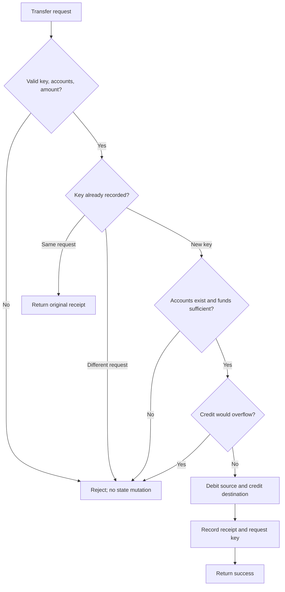

# COSMOS-047 — Settlement invariants before SDK wiring

Status: **First domain-model lab drafted; local execution evidence pending.** This lab is intentionally separate from a Cosmos SDK module. It isolates business/accounting invariants so they can be understood and tested before they are wired into consensus-backed application state.

## Learning objective

Explain and test why a settlement transfer must validate all conditions before changing either account, conserve total balances, reject overspending, and treat retries safely.

## Bank-transfer example

Bank A has 1,000 minor units and Bank B has 250. A valid transfer of 300 should leave A with 700 and B with 550. The combined total remains 1,250. If A has only 100 and requests 101, the transfer must fail and both balances must remain unchanged.

Use integer minor units, not floating-point money. Asset/denomination, precision, authorization, and issuance policy are still design decisions for the actual network.

## Invariants

1. **Positive amount:** amount > 0.
2. **Distinct accounts:** source and destination are different.
3. **Account existence:** both accounts exist.
4. **No overdraft:** source balance >= amount.
5. **Conservation:** source decreases by amount and destination increases by the same amount.
6. **Atomic rejection:** any validation failure leaves both balances unchanged.
7. **Idempotent retry:** the same idempotency key and same request returns the original receipt without applying the transfer twice.
8. **Conflicting replay rejection:** the same key cannot be reused for different transfer details.
9. **Overflow safety:** a destination balance cannot wrap around the integer limit.
10. **Concurrent safety in the model:** competing transfers cannot spend the same in-memory funds twice.

## Transaction shape



## Implementation location

Product repository: `hari-devloper/institutional-settlement-network`, module `app/settlement-domain`.

- `ledger.go`: synchronized in-memory state and validation-before-mutation.
- `ledger_test.go`: success, rejection, conservation, idempotency, overflow, and concurrency tests.
- `README.md`: run commands and scope limitations.

## Commands and evidence

Run from the product repository:

```bash
cd app/settlement-domain
go test ./...
go test -race ./...
```

**Expected:** both commands exit successfully; the race run reports no data races.

**Observed result:** pending. Do not mark tests passed until the commands are actually run and their output is recorded. The model has not yet been compiled or executed in this learning record.

## Critical limitation

This is a local Go domain model, **not a Cosmos SDK module**. A process mutex is not consensus, durable storage, or protection across validators. The next integration step must implement the same invariants against the SDK's deterministic transaction context and store, with pinned-version source references and tests proving success/failure/commit behavior. Do not infer SDK rollback semantics from this in-memory model.

## Interview questions

1. Why use integer minor units instead of float64 for money?
2. Why validate the destination overflow before mutating the source balance?
3. What does idempotency protect against, and why reject a key reused for a different request?
4. Why is a process mutex insufficient for a distributed blockchain?
5. Why does a PostgreSQL balance projection not prove authoritative settlement?
6. Which tests prove conservation, and which test proves concurrent overspend prevention?

## Mastery check

Without looking at the code, explain the difference between:
- validation atomicity in this model,
- process-level concurrency safety,
- deterministic state transition execution inside a Cosmos SDK application, and
- finality/commit evidence on a running chain.

Do not advance this concept to implementation mastery until test output and SDK integration evidence are recorded.
