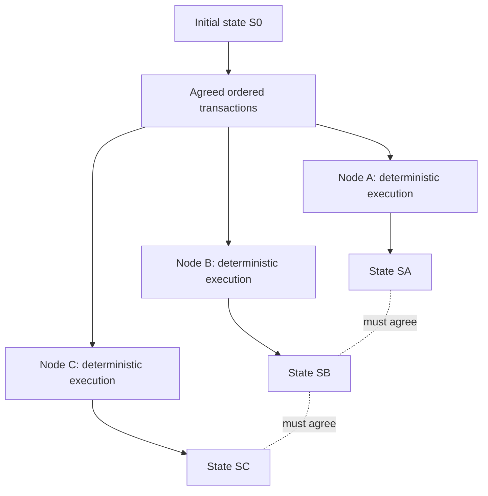

# Module 1 — Distributed Systems and Deterministic State Machines

- **Module ID:** COSMOS-FOUND-001
- **Status:** Learning draft; conceptual material, not a version-pinned Cosmos source walkthrough
- **Project sequence:** Single-chain settlement first; IBC is deferred
- **Purpose:** Establish the distributed-systems model needed to reason about blockchain execution and institutional settlement.

## Learning outcomes

After completing this module, the learner should be able to:

1. Explain why a blockchain is a distributed system rather than merely a database.
2. Define state, command/transaction, transition function, deterministic execution, and replicated state machine.
3. Distinguish consensus ordering from deterministic transaction execution.
4. Explain safety and liveness and give an example of each.
5. Identify common sources of nondeterminism and state divergence.
6. Apply these ideas to a single-chain institutional settlement example.

## 1. The core mental model

A blockchain maintains a state machine whose state is replicated across multiple machines. Participants must agree on an ordered sequence of accepted transactions, and honest nodes must apply that sequence according to compatible deterministic rules.

A simplified model is:

**new_state = transition(old_state, transaction)**

For a sequence of transactions, each transaction is applied to the result of the previous transition. The state after transaction n is the result of applying transactions 1 through n, in order, starting from the initial state.

Here:
- **State** is the data that defines the current system condition.
- **Transaction/command** is a proposed request to change state.
- **Transition function** defines whether and how a request changes state.
- **Deterministic** means the same valid starting state, transaction, and relevant protocol rules produce the same result.
- **Consensus** is the protocol by which nodes agree on an ordered history or block decisions, under stated assumptions.
- **Replication** means multiple nodes maintain copies of the state by processing the same agreed history.

This is a conceptual model. Exact implementation details vary by blockchain and software version.

## 2. Why this is not just a database

A conventional database typically coordinates reads and writes through its own transaction and replication mechanisms. A blockchain adds a protocol for independently operated nodes to agree on the canonical ordered history under a fault model, then apply protocol-defined state transitions.

The distinction is not that databases cannot be distributed or replicated; they can. The key distinction is the blockchain's consensus and state-transition protocol, plus its assumptions about participating nodes and faults.

For the Institutional Settlement Network:
- The chain's state is authoritative for accepted settlement state.
- A PostgreSQL read model/indexer is a derived view for search, reporting, and user interfaces.
- The read model must be rebuildable from the authoritative chain history.
- A database row in the read model must not independently authorize settlement.

## 3. Replicated state machine

Each validator/node conceptually processes the same ordered input history against the same initial state and protocol rules.

The goal is not that every node has identical hardware or timing. The goal is that, given the same protocol-defined inputs and starting state, execution yields the same protocol-defined result.

## 4. Consensus is not the same as execution

Think of two related responsibilities:

1. **Ordering/agreement:** Which transactions are included, and in what order?
2. **Execution/state transition:** Given that ordered input, what state changes result?

Consensus does not make arbitrary nondeterministic application code safe. If two honest nodes execute the same transaction differently because the application depends on local time, randomness, map iteration order, an external API response, or local machine state, their state can diverge.

Conversely, deterministic execution does not by itself decide which of two conflicting transactions should come first. An ordering/agreement protocol is needed.

A simple example: Alice has 100 units and submits two transfers of 80 units to different recipients. The application must define what happens based on the agreed order. With sequential execution and a balance check, the first valid transfer may succeed and the second may fail for insufficient funds. All nodes must apply the same order and rules.

## 5. Determinism: what it requires

Application execution should derive its result from protocol-defined inputs:
- the prior state;
- the transaction bytes/decoded message under the protocol rules;
- the transaction's position/order where relevant;
- explicitly defined block context and protocol parameters;
- deterministic validation and arithmetic rules.

Dangerous implicit inputs include:
- wall-clock time from a node's local operating system;
- network calls to external services during state transition;
- unseeded or node-local randomness;
- environment variables or local files that differ by node;
- iteration or serialization behavior that is not made canonical where ordering matters;
- floating-point arithmetic where cross-platform reproducibility is not guaranteed;
- integer overflow or inconsistent rounding/decimal rules.

This list is a review checklist, not a claim that every use of these facilities is always forbidden in every part of a blockchain application. The question is whether the behavior can affect consensus-critical state transitions.

## 6. Safety and liveness

**Safety** means the system does not reach an unacceptable contradictory outcome. In settlement, an example is preventing the same funds from being spent twice in the authoritative state.

**Liveness** means the system can continue making progress under the protocol's stated assumptions. For example, valid transactions eventually get included when the network and validator assumptions needed by the protocol hold.

These goals can come into tension during failures. A system may stop finalizing while preserving safety rather than risk accepting conflicting histories. Exact guarantees depend on the consensus protocol, its fault assumptions, network conditions, and implementation.

Do not say “blockchain is always available” or “transactions can never be reversed” without naming the protocol and assumptions.

## 7. Institutional settlement example

Suppose account A has 100 settlement units and requests a transfer of 70 units to account B.

A simplified state transition could be described as:

1. Authenticate/verify the transaction according to chain rules.
2. Check that A exists and has at least 70 spendable units.
3. Check applicable account status, denomination, limits, and authorization rules.
4. Debit 70 from A and credit 70 to B atomically.
5. Record the accepted result in the chain's transaction/event history.

The example omits real cryptography, fees, module boundaries, and authorization details; it is a teaching model, not a final application specification.

Potential invariants:
- A transfer cannot debit more than the sender's spendable balance.
- A successful transfer conserves value, except for explicitly modeled fees, minting, burning, or other issuance rules.
- A transaction cannot be applied twice if its replay-protection mechanism says it is a duplicate.
- A rejected transaction does not partially mutate settlement state.
- Read-model data cannot override chain-authoritative state.

Before implementation, the project must define units/denominations, account identity, authorization, replay protection, fees, transaction status semantics, and failure/recovery behavior.

## 8. Failure thought experiments

### Experiment A — Local clock dependency
Imagine an execution rule that accepts a transaction only if a node's local clock says it is before 12:00. Two nodes with skewed clocks may disagree. The lesson: consensus-critical decisions must use protocol-defined time/context, not arbitrary local wall-clock readings.

### Experiment B — External API dependency
Imagine a state transition calling a price API. One node receives 101.2 and another receives 101.4, or one request times out. The same transaction can produce different state. The lesson: external data must enter through a protocol-defined, agreed mechanism rather than uncoordinated network calls during deterministic execution.

### Experiment C — Conflicting transfers
A has 100 units. Two transfers each attempt to send 80. With a single agreed ordering and sequential balance validation, at most one can succeed unless the application explicitly permits credit/overdraft semantics. The invariant must be enforced by authoritative state-transition logic, not just the UI or read model.

### Experiment D — Read-model outage
The chain continues processing but the PostgreSQL indexer is offline. The user-facing explorer may be stale or unavailable, but PostgreSQL must not become an alternative settlement authority. Recovery should replay/reconcile the chain history and restore the derived view.

## 9. Interview questions

1. What is a replicated state machine?
2. Why does deterministic execution matter when consensus already exists?
3. How are consensus and transaction execution different?
4. Give three examples of nondeterministic inputs that could cause state divergence.
5. Explain safety versus liveness using a settlement example.
6. Why should PostgreSQL be treated as a rebuildable read model in this project?
7. What does it mean for a transaction to be applied atomically?
8. If two transfers overspend the same balance, where must the invariant be enforced and why?
9. Can a distributed database also have consensus? Explain why “blockchain versus database” is an oversimplification.
10. What assumptions must be stated before making a claim about finality or availability?

## 10. Mastery exercise

Write short answers in your own words:

- [ ] Draw a replicated state machine with at least three nodes.
- [ ] Explain ordering versus execution using two conflicting transfers.
- [ ] List five sources of nondeterminism and say whether each can affect consensus-critical state.
- [ ] State three settlement invariants.
- [ ] Explain how the system recovers its PostgreSQL read model after an outage.
- [ ] Explain one safety property and one liveness property.
- [ ] Answer all ten interview questions without copying this document.

## 11. Evidence and implementation status

- **Conceptual explanation:** included in this module.
- **Diagrams:** conceptual Mermaid diagram included; rendering should be checked in the target GitHub UI.
- **Runnable lab:** not yet implemented.
- **Failure experiments:** thought experiments only; no execution results claimed.
- **Cosmos SDK/CometBFT source call paths:** intentionally not included yet. The project has not locked and verified the initial dependency baseline.
- **Tests/performance measurements:** none claimed for this module.
- **Next gate:** learner can explain the core model and complete the mastery exercise; then continue to Module 2 on consensus, fault models, and finality, while verifying version-pinned sources before making implementation-specific claims.
