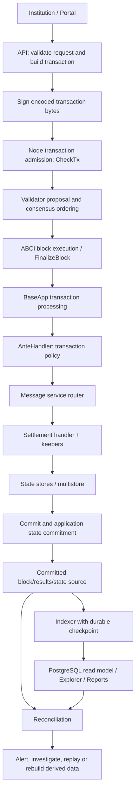

# Module 5 — Cosmos Deep Architecture: History, Design Philosophy, and Execution Internals

- **Module ID:** COSMOS-ARCH-001
- **Status:** Deep learning chapter; historical context and architecture concepts with a version-pinned source investigation plan
- **Last revised:** 2026-10-25
- **Prerequisites:** COSMOS-FOUND-001 through COSMOS-FOUND-004
- **Project sequencing:** Learn and review with GPT first; implement with Codex only after approval. Single-chain settlement first; IBC implementation later.
- **Version decision:** No final SDK/CometBFT dependency baseline is approved. Source investigation examples use the official Cosmos SDK v0.54.4 tag where stated; do not silently generalize these details to other versions.

> This chapter is deliberately much deeper than an introductory component diagram. It explains why Cosmos was created, what problems its architecture tries to solve, what it trades away, and how to investigate application internals. It is not a substitute for tracing every symbol and running the lab against the exact dependency baseline before coding.

## Learning outcomes

After studying this chapter, the learner should be able to:

1. Explain the historical problem that Tendermint and Cosmos were designed to address.
2. Distinguish Cosmos as an ecosystem/network vision, Cosmos Hub as one blockchain, Cosmos SDK as a framework, and CometBFT as consensus/node software.
3. Compare a general-purpose smart-contract chain with a purpose-built Cosmos SDK application chain.
4. Explain the architectural boundary between consensus and application execution, including benefits and costs.
5. Describe BaseApp, modules, keepers, stores, message/query routers, ante handling, gas, and events.
6. Reason about transaction checking, proposal handling, deterministic execution, state commitment, and read-model projection.
7. Explain application-specific sovereignty, validator-set responsibility, upgrades, interoperability, and operational trade-offs.
8. Navigate version-pinned source and distinguish verified facts from conceptual models and assumptions.
9. Apply these concepts to the Institutional Settlement Network design without prematurely choosing implementation details.

---

## Part I — History and the problem Cosmos was trying to solve

## 1. Before Cosmos: why building a blockchain was expensive

A blockchain is not only a database with hashes. A functioning chain has to coordinate several hard problems:

- **Networking:** discover peers, maintain connections, propagate transactions and blocks, and handle slow or unavailable peers.
- **Consensus:** cause independent nodes to agree on one ordered history despite failures and malicious participants.
- **State transition:** deterministically decide what each transaction does to application state.
- **Cryptography:** sign transactions, verify signatures, hash data, and authenticate protocol messages.
- **Persistence:** store blocks and application state, recover after restart, and commit consistent versions.
- **Economics and governance:** define validator incentives, staking, slashing, upgrades, and parameter changes where applicable.
- **Interfaces:** provide transaction submission, queries, events, and tools for wallets, applications, explorers, and operators.
- **Operations:** upgrade software safely, monitor consensus, handle key security, recover nodes, and respond to incidents.

Building all of these from scratch creates a large attack surface. Reusing components can reduce duplicated engineering, but it also creates dependency and compatibility constraints. Cosmos' architectural response was to provide reusable consensus/networking and application-building infrastructure while leaving each chain significant control over its application.

## 2. Tendermint's origin and motivation

The Tendermint project dates to 2014. The motivation described in Cosmos historical materials was to offer a different route from proof-of-work systems such as Bitcoin: use Byzantine-fault-tolerant consensus and validator voting rather than mining to produce blocks.

The important engineering idea was **separation of concerns**. A consensus engine should be able to order transactions and commit blocks without hard-coding every application's business model. A separate deterministic application should define what those ordered transactions mean.

The original Cosmos whitepaper describes Tendermint Core as an application-agnostic consensus engine connected to an application through the Application Blockchain Interface (ABCI). Its example is instructive: a Bitcoin-like application could use the engine for transaction propagation and ordering while the application itself maintains the UTXO database, validates transaction credentials, prevents spending nonexistent funds, and answers queries.

This reduces the amount of consensus machinery each application developer must recreate. It does **not** remove the need to implement business correctness, deterministic state transitions, key management, or chain operations.

Primary references:
- [Original Cosmos whitepaper — Cosmos: The Internet of Blockchains](https://legacy.cosmos.network/whitepaper/)
- [Cosmos/Tendermint whitepaper source](https://github.com/cosmos/cosmos/blob/master/WHITEPAPER.md)
- [Interchain Developer Academy — A Blockchain App Architecture](https://ida.interchain.io/academy/2-cosmos-concepts/1-architecture.html)

## 3. From Tendermint to Cosmos

The broader Cosmos vision expanded beyond reusing a consensus engine. It proposed a network of **independent blockchains**—historically described as zones—that could run their own application logic and validator policies while communicating through a standardized inter-blockchain protocol.

The Cosmos Hub launched in March 2019 and became the first public blockchain built with the Cosmos stack. Do not equate the Hub with the entire Cosmos ecosystem: the Hub is one chain; the Cosmos SDK is a framework; CometBFT is consensus/node software; and IBC is an interoperability protocol implemented by participating chains.

The early vision used a hub-and-zone explanation. That is useful historically, but the modern ecosystem should not be understood as requiring every chain to route every message through one central hub. The interchain is a network of chains and connections; a hub is a role a chain can play, not a universal execution coordinator.

References:
- [Cosmos Hub overview](https://cosmos.network/explore)
- [Original Cosmos whitepaper](https://legacy.cosmos.network/whitepaper/)

## 4. Timeline: concepts, not a complete corporate history

| Period | Architectural milestone | Why it matters |
|---|---|---|
| 2014 | Tendermint research/project origin | BFT consensus and application separation were central motivations |
| 2016-era Cosmos design | Cosmos whitepaper and network vision | Extend reusable consensus into an interoperable network of application-specific chains |
| 2019 | Cosmos Hub launch | The stack moved from design to a live public blockchain |
| Ecosystem growth | Cosmos SDK adopted for many application-specific chains | Teams could build chain-specific application logic without implementing every layer from scratch |
| Tendermint renamed/reorganized as CometBFT | Current naming separates the consensus software identity from the historical Tendermint name | Documentation and source browsing must account for legacy names |
| Ongoing SDK evolution | ABCI APIs, state handling, modules, transaction execution, and dependencies evolve | Old tutorials can be conceptually useful but wrong about exact symbols and call order |

This is a learning timeline, not an exhaustive corporate history.

## 5. Name the things correctly

- **Cosmos (ecosystem/network vision):** the broader collection of chains, protocols, tools, communities, and infrastructure.
- **Cosmos Hub:** a specific live blockchain with its own state, governance, validator set, and native economic model.
- **Cosmos SDK:** a Go framework for constructing application-specific blockchains from reusable components plus application-specific code.
- **Tendermint:** the historical name associated with the consensus project and early architecture.
- **CometBFT:** the current name of the consensus/node software line formerly known as Tendermint Core.
- **ABCI:** the application interface through which the consensus/node layer communicates with an application.
- **IBC:** a protocol family for authenticated communication between chains; intentionally deferred as an implementation topic in this project.
- **CosmWasm/wasmd:** an optional smart-contract runtime/integration for compatible Cosmos SDK chains, not a required part of every Cosmos chain.
- **Appchain:** a blockchain designed around the needs of a particular application or application family, with its own application state and governance/validator assumptions.

Confusing these terms causes architectural mistakes. “Cosmos is one blockchain” is misleading; “all Cosmos chains share one global state” is false; and “the Cosmos Hub validates every transaction on every Cosmos chain” is not how application-specific chains work.

---

## Part II — What makes Cosmos different?

## 6. Application-specific chains versus a general-purpose smart-contract chain

A general-purpose smart-contract platform offers a shared execution environment where many applications deploy contracts against common chain state and a common resource model. This can provide a common user base, shared liquidity, and composability within that chain, but applications share blockspace and must work within the platform's execution model.

A Cosmos SDK chain lets the team build much more of the chain's application layer directly into the chain software. It can define native transaction types, state layout, module interactions, authorization, governance, gas behavior, application interfaces, and chain-specific execution logic. This can be valuable when an application needs custom transaction semantics or a dedicated operational and governance model.

| Dimension | General-purpose smart-contract platform | Cosmos SDK appchain |
|---|---|---|
| Main application model | Contracts in a shared execution environment | Native application modules, optionally plus contracts |
| Execution customization | Bounded by the platform's contract VM and protocol | More control over application code and transaction semantics |
| Shared blockspace | Usually shared by many applications on the chain | Chain can dedicate blockspace to its application domain |
| Validator set | Determined by the host platform | Chain's own validator/security model must be designed and operated |
| Upgrades | Contract and host-protocol upgrades follow platform rules | Application/chain binary upgrades and state migrations require coordination |
| Composability | Often straightforward among contracts in one shared state machine | Native within the chain; cross-chain interactions need explicit failure handling |
| Operational burden | Often lower for an app team deploying a contract | Higher: chain lifecycle, validators, upgrades, state sync, monitoring, incidents |
| Control | Limited by host protocol | Greater control, with greater responsibility |

This is not a universal performance ranking. The right choice depends on trust assumptions, throughput patterns, interoperability requirements, governance, security budget, operational maturity, and application constraints.

## 7. Sovereignty has a price

A Cosmos SDK chain can own its application logic and state transitions. That sovereignty is useful for institutional workflows that need specialized account models, permission rules, settlement messages, audit events, or upgrade controls.

But a separate chain also needs a credible validator set, secure consensus keys, reliable infrastructure, monitoring, software upgrades, governance, and a response plan for outages. Application-specific sovereignty does not automatically create economic security or decentralization.

For the Institutional Settlement Network, do not claim “institutional grade” merely because the project uses Cosmos SDK. Explicitly design:
- who may operate validators;
- how validator power and admission/removal are governed;
- what failure and collusion thresholds are acceptable;
- how chain upgrades are approved and executed;
- how signing keys and institutional identities are controlled;
- how settlement correctness is tested;
- how the service behaves when consensus stops progressing;
- how operators recover and reconcile after failures.

These are product and governance decisions, not defaults guaranteed by the framework.

## 8. Why a modular framework matters

The SDK's modular approach lets an application compose reusable functionality rather than reimplement accounts, fees, staking, governance, upgrades, and other common chain capabilities from scratch. An application typically wires modules and their dependencies into an application type built around the framework's core application abstraction.

The advantage is reuse and explicit architecture. The cost is that module APIs, store schemas, initialization order, dependencies, and upgrade paths become part of the chain's compatibility contract. A module can be easy to import and still be unsafe to configure or incompatible with a chosen release.

**Modularity does not mean arbitrary hot-plugging.** A compiled chain binary has a defined module set and wiring. Adding or changing a module is a software and state-migration change, not simply a runtime toggle in a live chain.

---

## Part III — Consensus and application state

## 9. Consensus answers a different question from the application

Consensus asks: **which block/history do validators commit under the protocol's assumptions?**

The application asks: **given the protocol-defined inputs and current application state, what deterministic state transition should occur?**

These are coupled but different jobs. A block can be agreed upon while containing a transaction that fails application-level execution or has no successful business effect, depending on the exact protocol and SDK lifecycle. Consensus agreement is not a business approval stamp. Equally, correct application rules cannot make the chain progress if the validator quorum cannot reach consensus.

The application must be deterministic because independent validators executing the same committed inputs from equivalent prior state must derive compatible results. Avoid dependence on uncommitted external HTTP responses, local environment variables, local files, unseeded randomness, local wall-clock readings, or nondeterministic iteration where it can affect state or consensus-visible outputs.

If external information is needed, design how it becomes a deterministic input—such as a signed transaction, a prior committed state value, or a protocol-defined mechanism—instead of having each validator independently query a live service during state transition.

## 10. CometBFT's role—and what it does not do

At a high level, CometBFT supplies node and consensus machinery, including peer networking, block/transaction propagation, validator voting, and block commitment according to its protocol.

It does not define your institutional business model. It does not know that an account represents a bank, that a transfer needs dual approval, that an account has a credit limit, or that a payment requires an audit record. Those semantics belong in the application and surrounding controls.

The exact internals of proposal selection, vote rounds, timeouts, evidence, block validation, and commit behavior require separate study of the chosen CometBFT version. The original Tendermint whitepaper explains the classical BFT intuition, including voting power and locking; current implementation details must be checked against the actual release source and documentation.

Reference: [Cosmos whitepaper — Tendermint consensus and validators](https://legacy.cosmos.network/whitepaper/).

## 11. ABCI is a boundary, not the business logic

ABCI provides the protocol interface between the consensus/node layer and the application. The separation allows the application to be a distinct component and historically enabled implementations in languages other than the consensus engine's language. In a Cosmos SDK chain, the SDK supplies a substantial Go application framework behind that boundary.

The interface has evolved. Older articles may describe methods such as BeginBlock, DeliverTx, EndBlock, and Commit as if they were the universal modern lifecycle. Newer CometBFT/SDK combinations use different request/response shapes and lifecycle phases, including proposal preparation/processing and block finalization. Never paste an old lifecycle diagram into a current design without checking its version.

For the source-reading exercise in this chapter, the SDK v0.54.4 file baseapp/baseapp.go includes these execution-mode names:
- ExecModeCheck
- ExecModeReCheck
- ExecModeSimulate
- ExecModePrepareProposal
- ExecModeProcessProposal
- ExecModeVoteExtension
- ExecModeVerifyVoteExtension
- ExecModeFinalize

Source: [Cosmos SDK v0.54.4 — baseapp/baseapp.go](https://github.com/cosmos/cosmos-sdk/blob/v0.54.4/baseapp/baseapp.go). These names are verified in that file. This list alone does not define the complete call order; that must be traced through matching source symbols and the CometBFT version.

---

## Part IV — Inside a Cosmos SDK application

## 12. BaseApp: the application framework core

BaseApp is the SDK abstraction implementing core application behavior. It provides application-side integration with ABCI, transaction/message and query routing, state management, execution contexts, and transaction execution infrastructure. An application generally defines its own application type and wires a BaseApp, store keys, keepers, module manager, and other components.

Think of BaseApp as a framework runtime for the chain's application, not the business module itself.

The v0.54.4 source file baseapp/baseapp.go declares BaseApp and NewBaseApp. Its fields include the database, commit multistore, transaction decoder/encoder, mempool, ante/post handlers, ABCI handlers, message/query routers, state manager, and execution-related configuration. The same file defines execution modes and contains transaction execution paths.

Source: [Pinned BaseApp source at SDK v0.54.4](https://github.com/cosmos/cosmos-sdk/blob/v0.54.4/baseapp/baseapp.go).

### What to investigate in BaseApp

Do not stop after reading the struct. Trace:
1. **NewBaseApp:** what defaults and routers are created?
2. **ABCI implementation methods:** how are requests mapped into application work?
3. **FinalizeBlock and related handlers:** how does block-level processing occur in this release?
4. **RunTx and helpers:** where are bytes decoded, basic message checks performed, ante handling called, messages dispatched, caches written, and events returned?
5. **State manager/context creation:** which state view does each execution mode see?
6. **Commit/state-hash path:** what application state is persisted and what commitment is returned to the node?
7. **Proposal handlers:** what is prepared, what is processed/validated, and what behavior is customizable?
8. **Error and panic recovery:** which errors abort a transaction, which roll back cached writes, and which can affect block processing?

Exact function relationships beyond the items explicitly verified above must be confirmed by following v0.54.4 source, not inferred from another release.

## 13. Modules: cohesive application capabilities

A module packages a capability or domain of application behavior. Common SDK modules cover concerns such as authentication/accounts, bank balances, staking, governance, slashing, distribution, upgrades, and others. The available module set changes across releases; do not assume every legacy module still exists or behaves the same in the chosen version.

For the settlement project, potential domain modules might eventually include participants, accounts, transfer instructions, approvals, settlement state, and audit events. These are **proposed project modules**, not existing Cosmos SDK modules. Before implementing them, decide whether each should be a separate module or a cohesive part of one initial settlement module.

A useful module boundary has:
- a clearly owned state namespace;
- explicit message/query interfaces;
- deterministic state transitions;
- authorization rules;
- invariants and error semantics;
- defined dependencies on other modules;
- genesis and migration behavior;
- events suitable for external consumers without leaking sensitive data;
- unit and integration tests.

Too few modules can create a monolith with unclear ownership. Too many tiny modules create needless cross-module calls, wiring, migration coordination, and conceptual overhead. The right boundary follows domain ownership and invariant ownership—not an arbitrary target count.

## 14. Keepers: controlled access to module capabilities

In SDK architecture, a keeper is a Go object through which code accesses and operates on a module's state and capabilities. It typically wraps store access and exposes methods that other modules or message handlers use.

A keeper is not automatically a database transaction, consensus engine, or security guarantee. Safety depends on its methods, authorization checks, contexts/caches, and how callers compose operations.

For design review, ask:
- Which keeper owns this state?
- Which methods can mutate it?
- Can another module bypass the intended invariant through a lower-level helper?
- Are cross-module dependencies explicit and narrow?
- Can a caller trigger a partial update if a later operation fails?
- Do tests exercise unauthorized callers and failures halfway through a transition?

For settlement, balance debits and credits must be composed so a failed transfer does not persist only one side. The exact mechanism depends on the selected SDK execution/cache model and module design; prove it in tests rather than rely on a naming convention.

## 15. State stores, keys, codecs, and committed state

The application needs a deterministic, persistent representation of state. Cosmos SDK applications commonly organize module state through store abstractions and a multistore, with codecs/serialization rules defining how structured values are represented as bytes. Store layout, key prefixes, schema conventions, and serialization affect state commitments, queries, upgrades, and migrations.

Important distinctions:
- **Application state:** authoritative data maintained by the chain application.
- **Store abstraction:** the application API for reading/writing key-value state.
- **Cache/branched state:** an isolated working view used to avoid persisting partial updates before an operation succeeds.
- **Committed state:** the version persisted at the protocol-defined commit boundary.
- **Application hash/root:** a cryptographic commitment associated with application state according to the selected implementation.
- **PostgreSQL read model:** a separate derived projection for queries and reports, not the chain's authoritative state.

Do not assume the store's underlying database is the same as the PostgreSQL database used by an external indexer. They serve different roles and have different trust/consistency semantics.

## 16. Context, gas, events, errors, and caches

### Context
The SDK context carries execution-related information such as block/transaction metadata, store access, gas accounting, event management, and other execution state. Its exact fields and APIs are version-specific. It is not merely a general-purpose HTTP request context.

### Gas
Gas is a resource accounting mechanism used by transaction execution and fee policies. It constrains computational/resource usage and helps protect a chain from unbounded work. Gas consumption, gas wanted, fees, block limits, and ante behavior must be examined in the chosen version and application configuration. Gas is not a direct measurement of wall-clock milliseconds.

### Events
Events expose structured execution observations for clients, indexers, and operators. They are not a substitute for authoritative state queries, and external indexers must tolerate retries, gaps, and lag. Do not put secrets or confidential institutional information in public events without an explicit privacy review.

### Errors
Errors determine whether a transaction/message succeeds, what state is retained, what the client observes, and whether retries are sensible. Error semantics are part of the application API. Avoid collapsing business rejection, malformed input, authorization failure, infrastructure outage, and ambiguous timeout into one generic status.

### Cache and atomicity
A cache or branched store can isolate writes until an operation succeeds. Exact rollback/write behavior must be traced through the chosen implementation. Test failures after the debit but before the credit, and verify that no partial settlement state becomes committed.

---

## Part V — Transaction processing, deeply

## 17. A transaction is not a single event

Keep these stages separate:
1. Client constructs a transaction object.
2. The transaction is encoded into bytes and signed according to the chain's transaction format.
3. The client broadcasts it to a node.
4. The node may perform checks and place it in a mempool; successful submission is not settlement.
5. The consensus/node layer proposes and processes candidate block data according to its protocol.
6. The application processes block transactions in the selected execution lifecycle.
7. Successful state writes are applied to the appropriate execution state; failures follow implementation rollback/error rules.
8. Block/application state is committed at the protocol-defined boundary.
9. The client queries the chain and/or observes events.
10. An external indexer projects committed information into PostgreSQL.
11. Reconciliation detects gaps or divergence between the chain source and the read model.

This is a conceptual end-to-end map. The exact order, including checking, proposal preparation, proposal processing, and finalization, is version-specific. Do not present it as a call-by-call trace until verified against the selected versions.

## 18. What is ante handling?

Ante handling is part of the transaction-processing pipeline in Cosmos SDK architectures. It commonly performs pre-message checks and operations such as signature/sequence/account validation, fee-related checks, and gas-meter setup, depending on the configured handler and SDK release.

Do not assume every chain uses identical ante logic. A chain can customize transaction rules, and SDK releases evolve these APIs. A successful ante phase does not mean every business message executed successfully or that business settlement is complete.

Trace the chosen BaseApp transaction path to determine:
- which checks run before messages;
- which writes from the ante phase are cached or persisted on failure;
- how fees and sequences behave when a message fails;
- how simulation differs from execution;
- how recheck differs from first-time checking;
- what error information reaches the client.

## 19. CheckTx/recheck versus committed execution

A mempool check helps a node decide whether a transaction is currently admissible for gossip or local queuing. State may change before the transaction is proposed or executed. A transaction that passed an earlier check can later fail during execution because state or ordering changed.

Keep these states separate:
- **Accepted by an RPC endpoint:** may only mean the request was received.
- **Passed a mempool check:** does not mean it was committed.
- **Included in a proposed block:** does not by itself prove successful application state transition.
- **Committed transaction result:** must be interpreted according to the selected protocol/API semantics.
- **Business completion:** may require additional workflow and reconciliation conditions beyond chain commitment.

Never let the UI show “settled” merely because it received a transaction hash or HTTP success response.

## 20. Proposal preparation and processing

Modern SDK/CometBFT source includes proposal-related execution modes. These are protocol hooks with a specific purpose: the application can participate in preparing candidate block contents and processing/validating proposals under the version's rules.

This matters because a naive mental model—validators receive a block and simply run transactions in a loop—omits protocol-defined phases. The details can affect ordering, mempool interaction, deterministic validation, vote extensions, and compatibility.

For the selected release, trace the actual handlers, their defaults, and what a custom chain can override. Do not customize proposal logic for this learning project until we understand the default behavior and can state a clear requirement.

## 21. Atomicity, deterministic ordering, and settlement invariants

For the simple no-overdraft transfer:
- Initial state: A = 100, B = 0.
- Transfer 1 requests A → B: 80.
- Transfer 2 requests A → C: 80.
- If transfer 1 is executed successfully first, the resulting spendable balance of A is 20.
- Transfer 2 must fail under the no-overdraft rule.
- The final state must not contain only one side of a failed transfer.
- Replaying an already-applied logical payment must not debit again.

The authoritative application state transition enforces balance and authorization invariants. Consensus ordering determines the sequence in which transitions are considered. The indexer must project committed outcomes idempotently. These are three related but distinct correctness responsibilities.

## 22. State commitment and the application hash

The application stores state and computes a commitment according to the selected storage/commitment implementation. The node/consensus protocol uses application results at the defined boundary to continue the committed history. Exact application-hash timing and meaning must be learned from the selected release's ABCI specification and source.

Do not equate:
- a transaction hash;
- a block hash;
- an application state hash/root;
- a PostgreSQL row ID;
- a business payment ID.

They identify different things and support different integrity claims.

---

## Part VI — Advantages, trade-offs, and failure modes

## 23. Why teams choose Cosmos SDK

Potential advantages include:
- direct control over application-specific transaction and state semantics;
- reuse of infrastructure instead of building all consensus/application plumbing from scratch;
- modularity for composing common chain capabilities;
- a Go implementation ecosystem;
- chain-level governance and upgrade choices;
- a native path to interoperable applications where the selected stack and counterparties support it;
- more direct control over execution logic than a contract-only application on a shared chain.

These are capabilities, not guarantees of security, performance, low cost, or decentralization.

## 24. The costs that are easy to underestimate

- **Validator security:** a new chain needs a credible validator set and threat model.
- **Operational complexity:** node upgrades, consensus keys, snapshots, pruning, state sync, alerts, and incident response are your responsibility.
- **Upgrade risk:** state layout and module changes require coordinated upgrades and migrations.
- **Dependency coupling:** SDK, CometBFT, IBC-Go, CosmWasm, protobuf tooling, and Go versions must be compatible.
- **Performance trade-offs:** consensus networking, signature verification, application execution, state storage, and indexing can each become bottlenecks.
- **Cross-chain complexity:** interoperability introduces proof verification, client updates, packet lifecycle, timeout, recovery, and reconciliation concerns; implementation is deferred in this project.
- **Composability:** independent chains do not share a single atomic transaction or global state by default.
- **Governance:** chain upgrades and validator policies require a clear decision process and emergency plan.
- **Privacy:** a public replicated state machine is not a confidential database by default.
- **Business correctness:** a framework cannot infer the intended accounting model or legal meaning of settlement.

## 25. Failure scenarios to reason through

### A. Consensus halts
If sufficient voting power is unavailable or network conditions prevent progress, new blocks may stop. Existing committed state and liveness are separate questions. Define alerts, operator response, and customer-facing status.

### B. Determinism bug
Different nodes derive different results from the same committed input because code depends on external state or nondeterministic behavior. This threatens chain correctness. Remove nondeterministic dependencies from consensus-critical execution.

### C. Module upgrade changes state layout
A new binary expects a different key layout or serialization format. Without a planned migration, startup or state access can fail or data may be misinterpreted. Pin versions, test migrations, and rehearse upgrades.

### D. Mempool acceptance mistaken for settlement
The UI reports a payment complete after submission, then execution fails. The interface must expose the actual lifecycle and avoid false success.

### E. Indexer falls behind or replays events
PostgreSQL is stale or processes duplicates. It must resume from a durable cursor, apply idempotently, expose lag, and reconcile against committed chain data.

### F. One module bypasses another module's invariant
A helper exposes direct balance writes and another module uses it without the intended transfer checks. Define state ownership and narrow capability boundaries; test forbidden paths.

### G. An upgrade is incompatible with a dependency
A newer SDK version changes a module or execution surface while an integration still expects an older API. Verify official release notes and compatibility, run clean builds/tests, and do not force incompatible dependencies with ad hoc replacements.

---

## Part VII — Apply the architecture to the Institutional Settlement Network

## 26. What belongs on-chain, and what belongs off-chain?

Proposed high-level division for the learning project:

**On-chain authoritative application state**
- approved institutional/account identifiers and authorization relationships, if the privacy and governance model permits them;
- settlement balances or ledger positions;
- transfer instructions and state transitions;
- approval/authorization state;
- deterministic status and audit events needed to reconstruct outcomes.

**Off-chain read/operations layer**
- PostgreSQL projection for efficient search/reporting;
- API gateway and user-facing API;
- React consoles for bank users, treasury, explorer, and network operations;
- observability, alerts, dashboards, and operational workflows;
- reconciliation jobs and audit/reporting exports.

This is a proposal, not a final privacy, compliance, or domain design. Do not put confidential bank/customer information on a public chain merely because it is technically possible. Privacy, legal requirements, participant permissions, and the threat model must be decided first.

## 27. Settlement invariants that must survive every layer

Candidate invariants:
1. A transfer cannot debit more than the allowed spendable balance unless a documented credit rule permits it.
2. A successful transfer debits and credits the same amount, adjusted only by explicit fees or issuance/burn rules.
3. A failed transfer does not leave a partial debit or credit.
4. Only an authorized signer/participant can cause a permitted transition.
5. A logical payment cannot be applied more than once under the agreed idempotency identity and scope.
6. Every state transition has enough provenance to explain its cause.
7. PostgreSQL is rebuildable and cannot independently authorize a settlement.
8. The UI distinguishes submitted, included/processed, committed, indexed, and business-complete states according to actual protocol semantics.
9. If the indexer is behind, the UI communicates staleness rather than fabricating current balances.
10. Recovery preserves auditability and does not silently rewrite committed history.

These invariants must become executable tests before product implementation is approved.

## 28. Proposed source and lab investigation sequence

No production module should be implemented yet. The first source-reading lab should be deliberately small and evidence-driven.

### Step 1 — Pin source references
Use the official SDK v0.54.4 tag for an initial reading exercise only, unless the dependency review chooses a different candidate. The project has not approved v0.54.4 as its final baseline.

Primary sources:
- [Cosmos SDK v0.54.4 baseapp/baseapp.go](https://github.com/cosmos/cosmos-sdk/blob/v0.54.4/baseapp/baseapp.go)
- [Cosmos SDK v0.54.4 go.mod](https://github.com/cosmos/cosmos-sdk/blob/v0.54.4/go.mod)
- [Cosmos SDK v0.54.4 release page](https://github.com/cosmos/cosmos-sdk/releases/tag/v0.54.4)
- [CometBFT v0.39.4 go.mod](https://github.com/cometbft/cometbft/blob/v0.39.4/go.mod)
- [Cosmos SDK v0.55.0 upgrade reference](https://github.com/cosmos/cosmos-sdk/blob/v0.55.0/UPGRADING.md)
- [Original Cosmos whitepaper](https://legacy.cosmos.network/whitepaper/)

The compatibility draft records module-file evidence, but it is not a completed application build or final dependency decision.

### Step 2 — Read BaseApp structurally
Open baseapp/baseapp.go at the exact tag. Locate:
- type BaseApp
- NewBaseApp
- ABCI handler methods related to finalization/proposal handling
- RunTx and helpers it calls
- state/context setup and commit-related paths
- message/query routers and handler wiring

Record exact symbol names and line references after inspecting the pinned source. Do not guess line numbers in this draft.

### Step 3 — Build a call graph from source, not memory
For one signed transaction, draw separate paths for:
- encoding/signing and client broadcast;
- node/mempool check;
- proposal preparation and proposal processing;
- finalization and per-transaction execution;
- ante checks and message dispatch;
- cache write or rollback;
- block/application commit;
- query/event observation;
- external indexer projection.

Label each edge with the exact source symbol or interface method verified in the selected release. If the source does not support a claimed edge, correct the diagram.

### Step 4 — Lab and failure injection
Once the environment and dependency baseline are approved:
- run a minimal chain locally;
- submit a valid transaction;
- submit an invalid transaction;
- trigger a message failure after an earlier message in the same transaction;
- verify the resulting state and events;
- inspect gas and error results;
- restart the node and query state;
- interrupt the indexer and verify replay/reconciliation separately.

Write expected results before running the experiment. Record actual output and exact commands only after the lab runs.

### Step 5 — Review gate
Before Codex implementation, the learner must be able to:
- explain the architecture from memory;
- trace the transaction path through source;
- explain failure and rollback behavior;
- describe the chosen dependency graph and evidence;
- pass the mastery questions;
- approve the domain and implementation plan explicitly.

---

## Part VIII — Advanced interview questions and model answer outlines

### 1. Why did Cosmos separate consensus from application logic?
**Answer outline:** Reuse consensus/networking machinery while allowing applications to define their own deterministic state machine. This avoids forcing every application to reimplement consensus, but shifts responsibility for application correctness and deterministic execution to the application.

### 2. Is Cosmos the same thing as the Cosmos Hub?
**Answer outline:** No. Cosmos is a broader ecosystem/network vision and stack; the Hub is one blockchain; the SDK is an application framework; CometBFT is consensus/node software; IBC is a cross-chain protocol family.

### 3. Why build an appchain instead of deploying a smart contract?
**Answer outline:** Appchains offer greater control over native transaction types, state model, execution, governance, and validator policy. The trade-off is operating a chain, securing its validator set, coordinating upgrades, and owning more infrastructure.

### 4. Does CometBFT guarantee that a transfer is valid?
**Answer outline:** No. Consensus determines committed history under protocol assumptions. Application logic enforces transfer rules and invariants.

### 5. Why is ABCI important?
**Answer outline:** It is the interface between the consensus/node layer and application. It establishes a contract between components, but its methods and lifecycle are version-specific.

### 6. What is BaseApp?
**Answer outline:** The SDK core application abstraction that provides ABCI integration, state/execution management, transaction and query routing, and common transaction processing facilities. Custom application wiring and modules provide chain-specific behavior.

### 7. What is the role of a keeper?
**Answer outline:** A module capability/state-access abstraction. Its safety depends on exposed methods, caller permissions, invariant enforcement, context/cache semantics, and explicit module dependencies.

### 8. Why are caches important in transaction execution?
**Answer outline:** They can isolate writes until an operation succeeds, preventing partial state updates. Exact semantics must be proven for the chosen execution path and tested under failure.

### 9. Does a transaction passing CheckTx mean it will succeed?
**Answer outline:** No. State can change, ordering can differ, and committed execution has protocol-defined semantics distinct from a mempool check.

### 10. Why can a chain be deterministic but still wrong?
**Answer outline:** Determinism ensures equivalent nodes produce equivalent results from equivalent inputs. It does not prove the business rules are correct; a deterministic bug can consistently produce the wrong state.

### 11. Why is the application hash different from a transaction hash?
**Answer outline:** A transaction hash fingerprints transaction bytes according to the protocol. An application state hash commits to a representation of application state. They have different scopes and meanings.

### 12. What are the costs of appchain sovereignty?
**Answer outline:** Validator/security responsibility, governance, upgrades, operations, state sync, monitoring, incident response, and potentially weaker shared liquidity/composability compared with a shared execution platform.

### 13. Why must module boundaries follow invariants?
**Answer outline:** State ownership and mutation paths determine whether invariants can be bypassed. Boundaries should make authorization and atomic transitions explicit, with tests for cross-module failure.

### 14. Why should a PostgreSQL indexer never be settlement authority?
**Answer outline:** It is a derived, potentially stale or duplicated projection. It can be rebuilt and reconciled from committed chain history, but should not independently authorize transfers.

### 15. How would you investigate an old tutorial's incorrect call path?
**Answer outline:** Identify the exact SDK and CometBFT tags, inspect dependency metadata and source, follow the entry point and called symbols, run tests or a trace, and update the diagram with source references. Never infer a current path from a legacy method name.

---

## Part IX — Mastery gate

Do not mark this module complete merely because it has been read.

- [ ] Explain the historical motivation for Tendermint and Cosmos without notes.
- [ ] Distinguish Cosmos, Cosmos Hub, Cosmos SDK, CometBFT, ABCI, IBC, and CosmWasm.
- [ ] Compare an appchain with a smart-contract deployment and state benefits and costs.
- [ ] Draw the architecture and label consensus, application state, API, and derived read model.
- [ ] Explain determinism and give three concrete failure examples.
- [ ] Explain BaseApp, modules, keepers, stores, contexts, gas, events, and caches.
- [ ] Trace the pinned SDK source for one transaction and cite exact symbols.
- [ ] Explain CheckTx/mempool behavior versus committed execution.
- [ ] Explain how a failed transfer avoids partial state writes, with test evidence after the lab exists.
- [ ] List at least five operational risks of running an appchain.
- [ ] Explain why IBC is deferred in this project's initial stage.
- [ ] Answer all 15 interview questions in your own words.
- [ ] Record unresolved questions and review the source links before implementation.

## Evidence status

- **Historical references:** linked to the original Cosmos whitepaper, current Cosmos/Interchain learning material, and official repository sources.
- **SDK v0.54.4 BaseApp source:** inspected for the BaseApp type, constructor, and execution-mode names.
- **Final dependency baseline:** not approved.
- **Complete transaction call graph:** not yet recorded; must be built by tracing exact source symbols.
- **Runnable lab/failure experiment:** not yet executed.
- **Tests, benchmarks, and production claims:** none claimed.
- **Next learning step:** do not rush to another high-level topic. Work through the Module 5 source investigation interactively: reconstruct the historical architecture, then inspect BaseApp and trace a transaction in pinned source before moving to the next module.

## Further reading

- [Original Cosmos whitepaper](https://legacy.cosmos.network/whitepaper/)
- [Cosmos SDK v0.54.4 source — BaseApp](https://github.com/cosmos/cosmos-sdk/blob/v0.54.4/baseapp/baseapp.go)
- [Cosmos SDK v0.54.4 module file](https://github.com/cosmos/cosmos-sdk/blob/v0.54.4/go.mod)
- [Cosmos SDK v0.55.0 upgrade reference](https://github.com/cosmos/cosmos-sdk/blob/v0.55.0/UPGRADING.md)
- [CometBFT v0.39.4 module file](https://github.com/cometbft/cometbft/blob/v0.39.4/go.mod)
- [Interchain Developer Academy — Cosmos SDK concepts](https://ida.interchain.io/academy/2-cosmos-concepts/)
- [Cosmos Stack roadmap for 2026](https://cosmos.network/blog/the-cosmos-stack-roadmap-2026)


## Learner checkpoint — architecture concepts (2026-10-24)

**Checkpoint:** 3/3 correct (100%) on the conceptual questions following Sections 1–8 of this chapter.

- **Q1 — separation of consensus and execution: correct.** Consensus establishes the agreed block/transaction order; the deterministic application applies business rules to the ordered input.
- **Q2 — app-specific chain trade-off: correct.** Chain-specific control comes with responsibility for validator security, operations, upgrades, and application correctness.
- **Q3 — meaning of CheckTx success: correct.** Admission success is not proof of block inclusion, commitment, or completed business workflow.

**Evidence limitation:** This checkpoint demonstrates conceptual understanding only. It does not establish source-level mastery, a runnable lab, a successful build, benchmark results, or production readiness.

**Next step:** inspect the selected learning reference version's `BaseApp`, ABCI entry points, transaction execution path, message routing, state cache/commit behavior, and event/query behavior. Keep SDK v0.54.4 a provisional source-study candidate only; do not treat it as an approved dependency baseline. Pin every source claim to the exact tag and symbol before documenting it as implementation fact.


## Source investigation 1 — BaseApp transaction lifecycle (2026-10-24)

**Reference pinned for study:** Cosmos SDK tag `v0.54.4`. This is a provisional reading reference, not an approved dependency baseline. Files inspected:

- `baseapp/baseapp.go` — blob SHA `4380d5da9c48945e8a2e1310be1af165d47af076`
- `baseapp/abci.go` — blob SHA `e7ef7c734c3c4cd2de8ba6781a2d33a26223a5a0`
- `baseapp/msg_service_router.go` — blob SHA `d6ecbadc9e78b44318b34d25314799e91102f9b3`

### Verified entry points and observed behavior

1. `BaseApp.CheckTx` in `baseapp/abci.go` selects new-check or recheck execution mode and calls `RunTx`. Its source comment says messages are not executed in CheckTx mode; validation and the AnteHandler are executed, and successful ante-state is retained in the internal CheckTx state. This is admission processing, not settlement.
2. `BaseApp.PrepareProposal` and `BaseApp.ProcessProposal` are separate ABCI entry points. The former prepares the transaction set for a proposed block; the latter processes a proposed block. Do not collapse either into the commit step.
3. `BaseApp.FinalizeBlock` is a wrapper that calls `internalFinalizeBlock` unless optimistic execution supplies a usable result. In the inspected source, `internalFinalizeBlock` calls pre-block and begin-block logic, then `executeTxsWithExecutor`, then end-block logic, and returns transaction results and other block-level outputs.
4. `executeTxsWithExecutor` uses the configured transaction runner and `app.deliverTx`; `deliverTx` calls `RunTx` in finalize mode.
5. `BaseApp.RunTx` decodes the transaction if necessary, obtains its messages, validates basic message requirements, checks that each message has a registered handler, and runs the AnteHandler when configured. It uses cached store branches. It then calls `runMsgs`; message execution is only performed in simulation/finalize modes, not ordinary CheckTx mode.
6. In finalize mode, the message cache is written only when message/post-handler processing succeeds. AnteHandler cache writes occur earlier, after successful ante processing. Therefore a failed message execution does not automatically imply that every ante effect is rolled back; fee/sequence behavior must be understood from the configured AnteHandler and tested.
7. `MsgServiceRouter.Handler` looks up a handler by `sdk.MsgTypeURL(msg)`. `RegisterService` registers handlers from a service description. A message type without a registered handler fails before message execution.
8. `BaseApp.Commit` invokes the optional pre-committer, commits the application multistore, runs commit listeners, resets CheckTx state to the latest committed state, clears finalize state, and triggers snapshot handling as configured. `workingHash` separately writes finalize state into the root multistore and calculates the working application hash before Commit flushes the state.

### Conceptual call path reconstructed from inspected symbols

```text
CheckTx
  -> RunTx(check/recheck)
     -> decode + basic validation + handler lookup
     -> AnteHandler (if configured)
     -> no business message execution in CheckTx

FinalizeBlock
  -> internalFinalizeBlock
     -> preBlock
     -> beginBlock
     -> executeTxsWithExecutor
        -> deliverTx
           -> RunTx(finalize)
              -> decode/validate/handler lookup
              -> AnteHandler (if configured)
              -> runMsgs
                 -> registered message handlers
              -> write message cache only on success
     -> endBlock
     -> response with transaction results

Commit
  -> multistore Commit
  -> commit listeners
  -> reset CheckTx state / clear finalize state
```

This is a source-derived summary of the inspected v0.54.4 files, not a claim that every optional hook, middleware, optimistic-execution path, or application-specific module is shown. The exact complete call graph still needs further tracing.

### ISN implications

- Never report “settled” from CheckTx success alone.
- A payment message should enforce sufficient funds and atomic debit/credit in authoritative application state.
- Test multi-message transactions and failed message handlers to prove no partial business settlement.
- Separately test ante effects such as fees and sequence handling; do not assume a failed message undoes all transaction-level effects.
- Indexing should consume committed results/state and be idempotent; an indexer retry must not apply the payment twice in the read model.
- Treat SDK version-specific lifecycle semantics as source facts only for the pinned tag above until a different baseline is approved.

### Evidence and gaps

- **Source inspection:** completed for the listed files and functions at tag v0.54.4.
- **Runnable lab/build/test:** not run.
- **Failure experiment:** not run.
- **Dependency baseline:** not approved.
- **Next:** inspect `runMsgs`, message service registration, the configured AnteHandler chain, store/cache semantics, and the application/module wiring; then design a minimal reproducible lab before considering implementation.


## Source-level mastery checkpoint — BaseApp (2026-10-24)

**Result: 3/3 correct (100%)**

- **Q1 — B: correct.** When message execution fails, the message-execution cache is not written through the successful finalize-mode path, preventing partial business-state changes from that cache.
- **Q2 — C: correct.** The AnteHandler cache can be written after successful ante processing and before message execution. Do not assume all fee/sequence effects are rolled back after a message failure; verify configured decorators and test behavior.
- **Q3 — A: correct.** `MsgServiceRouter.Handler(msg)` looks up the registered handler using the message type URL.

**Evidence boundary:** This is a source-reading checkpoint, not a runnable lab or test. It demonstrates understanding of the inspected source behavior but does not prove the application is configured correctly or production-ready.


## Source investigation 2 — AnteHandler and module wiring (2026-10-24)

**Reference pinned for study:** Cosmos SDK `v0.54.4`. This remains a source-study candidate, not an approved dependency baseline.

Files inspected:
- `baseapp/options.go` — blob SHA `86eb3fdd8f099806cfa44130c2c5beae68c428dc`
- `types/handler.go` — blob SHA `4c453aa5b7cee5482bc28f32095f3d94faa1fa99`
- `x/auth/ante/ante.go` — blob SHA `944b825e693ac4ea4f5ad4e6b943c2f0ff314af4`
- `types/module/module.go` — blob SHA `43d75538041e28bd84c9fa9a3b0bdb7dcfea4f92`
- `simapp/app.go` — blob SHA `0b33f054305096cee2e2231cfe3ab1cd266dcdea` (reference application's wiring example, not a template to copy blindly)

### A. AnteHandler construction and attachment are separate steps

The default auth ante builder, `ante.NewAnteHandler(HandlerOptions)`, validates required dependencies (including AccountKeeper, BankKeeper and SignModeHandler) and creates an ordered list of decorators. The inspected default order is:

1. SetUpContext
2. ExtensionOptions
3. ValidateBasic
4. TxTimeoutHeight
5. ValidateMemo
6. ConsumeGasForTxSize
7. DeductFee
8. SetPubKey
9. ValidateSigCount
10. SigGasConsume
11. SigVerification
12. IncrementSequence

This is the default builder's sequence in this exact source version. It is not a universal guarantee for every Cosmos application; custom handlers and options can change the chain.

The function returns `sdk.ChainAnteDecorators(anteDecorators...)`. The separate `BaseApp.SetAnteHandler(ah)` method stores the constructed handler and panics if called after BaseApp is sealed. Thus, building the chain and attaching it to the application are distinct wiring steps.

### B. Decorator order is behavior, not cosmetic style

In `types/handler.go`, `ChainAnteDecorators` explicitly says the first decorator is outermost and the last is innermost. Each decorator wraps the next handler. The source warns that gas-meter setup must be the first decorator in applications using a GasMeter; otherwise processing could use an infinite gas meter and create a denial-of-service risk.

For ISN, never reorder fee, signature, sequence or gas decorators by intuition. Any customization must be justified against the exact SDK contract, tested, and documented.

### C. Module registration, service registration and lifecycle order are different concerns

The inspected `types/module/module.go` defines module-manager behavior. `Manager.RegisterServices(cfg)` asks modules that implement the service interfaces to register message/query services with the configurator and returns registration errors. In `simapp/app.go`, the reference application constructs a `module.Manager`, configures explicit ordering for pre-block, begin-block, end-block and genesis hooks, creates a configurator with the message and gRPC query routers, and calls `RegisterServices`.

Do not confuse these mechanisms:
- **Module construction:** creates module instances and supplies their dependencies.
- **Service registration:** makes message/query service implementations discoverable through routers.
- **Block-hook ordering:** controls ordered pre-block/begin-block/end-block module calls.
- **AnteHandler chain:** performs transaction-level checks/effects before business-message execution.
- **Message handler:** implements the semantics of a particular message.

A service can be registered correctly while its business logic is still incorrect. A module can exist in the manager without automatically implying that every desired message/query route is registered. App wiring must be inspected.

### D. Reconstructed wiring path in the reference app

```text
Construct keepers and module instances
  -> module.NewManager(...)
  -> configure explicit lifecycle ordering
  -> create Configurator(message router, gRPC query router)
  -> ModuleManager.RegisterServices(configurator)

Separately:
  ante.NewAnteHandler(HandlerOptions)
    -> ChainAnteDecorators(ordered decorators)
    -> BaseApp.SetAnteHandler(anteHandler)
```

This summarizes the inspected SimApp example. It is not an ISN implementation and must not be copied without architecture and compatibility review.

### E. ISN design rules derived from this investigation

- Specify the exact transaction ante policy before implementing payment messages: signers, authorization, fees (if any), sequence/replay behavior, gas limits, timeouts and failure semantics.
- Decide which SDK-provided account/bank/auth capabilities to reuse versus which settlement-specific state and handlers are custom.
- Register settlement message services through the selected SDK's supported wiring and prove routes resolve in tests.
- Review lifecycle ordering only for modules that actually implement those hooks; document why any explicit ordering is required.
- Test malformed/unsigned transactions, invalid signatures, insufficient funds, repeated submissions, failed message execution, and the resulting committed account/sequence/fee state.
- Keep client API status separate from chain commitment and downstream reconciliation status.

### Evidence and gaps

- **Source inspection:** completed for the files listed above at tag v0.54.4.
- **Mastery checkpoint:** 3/3 correct for the previous BaseApp/cache questions.
- **Runnable lab/build/test:** not run.
- **ISN app wiring:** not implemented.
- **Dependency baseline:** not approved.
- **Next:** design the minimal source-backed lab and test matrix; then inspect account/bank keeper semantics and exact state-cache behavior before any implementation proposal is approved.


## End-to-end integration: how every Module 5 concept connects

**Companion diagrams (rebuilt after review):** [Cosmos component architecture — deeper component map](../diagrams/MODULE-05-cosmos-component-architecture.mmd) covers the node, CometBFT, ABCI, BaseApp, module wiring, routers, keepers, stores, state commitment, client interfaces, and operations. [Transaction lifecycle — detailed flow](../diagrams/MODULE-05-transaction-lifecycle-deep-dive.mmd) follows admission through proposal/consensus, `FinalizeBlock`, transaction/message failure paths, `Commit`, indexing, and reconciliation. They are grounded in official Cosmos SDK documentation listed in their source comments; exact behavior still must be checked against the dependency version selected for the project.

- **Integration ID:** COSMOS-ARCH-001-E2E
- **Updated:** 2026-10-25
- **Purpose:** One connected narrative for the entire module. Read this after the earlier deep-dive sections; it ties the individual concepts together instead of treating them as isolated definitions.
- **Evidence rule:** Architecture explanations below are learning material. Version-specific behavior is only asserted where the pinned v0.54.4 source investigations above support it. No runnable ISN app, passing build, or failure experiment is claimed here.

### 1. The complete mental model

The Institutional Settlement Network (ISN) is being studied as an application-specific chain for institutional transfers. The chain's committed application state is the settlement authority. APIs, explorers, PostgreSQL tables, dashboards, and reporting are clients or derived views; they must not independently decide that money moved.

The layers answer different questions:

| Layer | Question it answers | ISN example | What it must not be mistaken for |
|---|---|---|---|
| Client / institution portal | What does an institution want to submit or inspect? | Prepare a transfer request | Settlement authority |
| API / transaction builder | How is a request converted into a correctly encoded, signed transaction? | Validate request shape, build bytes, request signature | Proof that a transfer committed |
| Transaction authentication / ante processing | Is this transaction admissible under the chain's transaction policy? | Signature, account sequence/replay checks, fee and gas policy | Institutional business authorization by itself |
| Consensus (CometBFT) | Which ordered blocks are agreed by validators under the configured fault assumptions? | Agree on block order | Proof that a transfer satisfies balance and policy rules |
| Application framework (ABCI boundary and BaseApp in an SDK app) | How are agreed blocks and transactions handed to deterministic application execution? | Run transaction processing and block lifecycle | Business policy automatically supplied by the framework |
| SDK modules, message services, keepers | What state transitions and queries does this application define? | Settlement module checks and applies a transfer | Permission to bypass another module's invariants |
| Stores / multistore / commit | Which application state is staged, committed, and represented by the chain's application commitment? | Persist resulting balances and transfer record | Same thing as a transaction hash |
| Indexer / PostgreSQL read model | How can committed chain data be searched and displayed efficiently? | Explorer history, reporting, reconciliation inputs | A second settlement ledger |
| Reconciliation / operations | Do derived views agree with authoritative chain records, and can gaps be repaired safely? | Detect a missing or duplicated indexed transfer | Permission to rewrite authoritative history |

**Key connection:** cryptographic identity tells us which bytes were signed and by whom; ante processing applies transaction-level rules; consensus establishes agreed ordering; deterministic application execution applies business rules; commit makes resulting application state durable according to the chain's commit protocol; the indexer projects committed facts for querying; reconciliation detects and repairs derived-view discrepancies.

### 2. End-to-end architecture map



This is a **conceptual system map**, not a complete source-level call graph and not an implementation diagram. Exact ABCI method names, hooks, middleware, and call paths must be checked against the selected release. The existing v0.54.4 investigation records a partial, source-derived path below.

### 3. One transfer from request to query: the ordered walkthrough

Use a hypothetical transfer of 1,000 units from Institution A to Institution B. This example is explanatory; it is not a statement that ISN's business rules or code have already been implemented.

1. **Define the business intent.** The API receives a transfer request. It checks request shape and returns clear validation errors. API validation improves usability but cannot replace on-chain checks, because clients can be bypassed.
2. **Build the transaction.** The client encodes a message using the chosen schema and signing mode. The transaction's identity/hash is a fingerprint of encoded transaction bytes under the relevant chain rules. It is not a balance, a transfer outcome, or proof of final settlement by itself.
3. **Sign the required bytes.** The signing key creates a signature that can be checked against the public key and signing rules. A valid signature establishes a cryptographic authorization fact under those rules; it does not automatically prove that the institution is permitted to transfer these funds under ISN's business policy.
4. **Run transaction admission checks.** A node may run `CheckTx` to decide whether a transaction is admissible to its mempool. The exact checks depend on the application and SDK configuration. A successful `CheckTx` is **not** settlement and does not guarantee inclusion or successful execution.
5. **Agree on block order.** Consensus orders proposed transactions into a block according to the chain's protocol and fault assumptions. Consensus does not independently understand the meaning of “Institution A pays Institution B.”
6. **Execute the agreed block.** The application processes the block through its ABCI boundary and SDK lifecycle. In the inspected SDK v0.54.4 path, `FinalizeBlock` enters `internalFinalizeBlock`, then block hooks and transaction execution; the exact configured path can include additional application-specific behavior.
7. **Run transaction-level policy.** The configured AnteHandler may check transaction properties, signatures, sequence/replay conditions, fees, and gas. Decorator order matters. These checks are separate from settlement-specific authorization and balance rules.
8. **Route the message.** The message service router maps a message type URL to a registered handler. A registered route only makes a handler discoverable; it does not make the handler's business logic correct.
9. **Apply settlement rules.** The settlement handler and keepers must validate the relevant institution permissions, transfer amount, account status, sufficient available funds, and any domain-specific limits. The exact policy is an ISN design decision still requiring specification.
10. **Stage state changes atomically.** Debit and credit must be part of one successful state transition. A failed business transfer must not leave only the debit or only the credit applied. State caches/branches and the precise SDK transaction semantics must be tested, not inferred from names.
11. **Finish block execution and commit.** Block lifecycle work completes and application state is committed according to the chain's protocol. The v0.54.4 source investigation documents the roles of `FinalizeBlock`, working state/hash calculation, and `Commit`; do not collapse these into a single generic “transaction succeeded” event.
12. **Expose committed facts.** A committed transaction result or committed block/state is the source for downstream indexing. The API should distinguish submitted, admitted, included, execution-success/failure, and committed/confirmed statuses according to the exact chain/client contract. Never label `CheckTx` success “settled.”
13. **Index idempotently.** The indexer consumes committed source data, stores a durable checkpoint, and upserts/deduplicates records using stable chain identity such as chain ID plus block height and transaction position/hash as appropriate to the selected source. Retries must not duplicate a transfer in the read model.
14. **Reconcile and recover.** Compare indexer progress and derived records with authoritative chain data. If PostgreSQL is missing a committed transfer, investigate the gap and replay/backfill or rebuild the derived projection. Do not change blockchain balances to match PostgreSQL.
15. **Report honestly.** The portal/explorer can show chain-derived status and indexer freshness separately. “Committed on chain” and “visible in reporting database” are different operational facts.

### 4. Lifecycle concepts that must not be confused

#### Transaction-level lifecycle

- **Encoding and signing:** produce a transaction representation and signature under defined rules.
- **CheckTx / recheck:** node admission/mempool-related processing; not committed business execution.
- **Proposal processing and consensus:** select and agree on block order according to the protocol.
- **FinalizeBlock / execution:** execute agreed block transactions and block lifecycle hooks in the application.
- **Commit:** commit application state and perform the release-specific commit work.
- **Indexing:** derive a queryable projection from committed data.
- **Reconciliation:** detect discrepancies between authoritative chain facts and derived data.

These are distinct stages. An API response should never merge all of them into a single ambiguous `success` boolean.

#### Module lifecycle and application wiring

A Cosmos SDK application also has a **startup/configuration lifecycle**, which is not the same as an individual transfer:

1. Construct application configuration and stores.
2. Construct keepers and module instances with their dependencies.
3. Register modules with the module manager as appropriate.
4. Configure explicit pre-block, begin-block, end-block, and genesis ordering for modules that implement those hooks.
5. Create the service configurator/router and register message and query services.
6. Construct and attach the AnteHandler separately from message-service registration.
7. Load or initialize genesis state and start the application using the selected release's supported setup path.

These steps are a conceptual checklist, not a universal exact function sequence. Follow the selected SDK version and reference application's actual source. **Construction, service registration, block-hook ordering, AnteHandler attachment, and message handling are different responsibilities.**

#### Genesis, export, upgrades, snapshots, pruning, and archives

- **InitGenesis:** initializes application/module state from the genesis document at chain initialization. Genesis state must satisfy the same core invariants expected of live state.
- **ExportGenesis:** exports module state for supported export/restart/migration workflows. It is not simply “copy the database”; module export semantics and version support must be checked.
- **Chain upgrade:** coordinates a planned software/state transition at a defined upgrade point. The upgrade plan, binary versions, migration code, recovery plan, and operator coordination need explicit tests.
- **Module migration:** transforms persisted module state between schema/logic versions. It must be deterministic, version-aware, and tested with representative prior state.
- **Snapshot:** a recovery/bootstrap artifact for restoring or quickly syncing state under the implementation's snapshot mechanism. Snapshot validity and restore procedures must be tested.
- **Pruning:** removes selected historical data to control storage use. Pruning policy changes what a node can serve locally; it must not be confused with reversing committed settlement.
- **Archival node:** retains more history to support long-range queries, audits, and rebuilding projections where the necessary source data is available. Archive capability, retention, and query guarantees must be explicit.
- **Application hash/state commitment:** a commitment to application state under the chain's encoding/store rules; not the same object as a transaction hash or a PostgreSQL checksum.

All of these are lifecycle/operations concepts that depend on the exact release and node configuration. The learner must not assume they are all configured or operational merely because a term appears in this chapter.

### 5. State, determinism, and settlement invariants

A deterministic state machine can consistently execute a **wrong** business rule. Determinism is necessary for replicated execution; it does not prove that the rule is correct.

Before implementation, write ISN invariants in testable language. Candidate invariants to refine with the domain model:

1. **No unauthorized transfer:** only the required authorized institution/identity can initiate the specified operation.
2. **No overspend:** a debit cannot reduce available balance below the permitted minimum.
3. **Value conservation:** for a simple internal transfer with no fee or issuance/burn, total value before equals total value after; if fees or other accounting entries exist, define the balancing equation explicitly.
4. **Atomicity:** a transfer either applies all required business-state updates or none of those business-state updates.
5. **Replay safety:** re-submitting the same signed transaction or business instruction cannot apply the economic effect twice; distinguish chain transaction replay rules from a domain-level idempotency key.
6. **Correct provenance:** every accepted state change is attributable to an authenticated transaction and its committed execution record.
7. **Read-model derivation:** PostgreSQL rows are reconstructible from the designated authoritative chain source and indexing rules.
8. **Checkpoint integrity:** the indexer checkpoint never claims progress beyond records safely processed and durably written.
9. **Determinism:** consensus-executed business logic must not depend on local wall-clock time, random values, unordered iteration, remote API responses, or node-specific environment state unless the protocol explicitly provides a deterministic input.
10. **Upgrade continuity:** genesis, upgrade, and migration paths preserve required invariants or reject invalid prior state with a defined recovery process.

The final invariant set is **not approved yet**. Each invariant needs a plain-language definition, a formal or executable assertion, a negative test, and evidence from the selected implementation.

### 6. Indexer, PostgreSQL, checkpoints, and reconciliation

The indexer is a derived-data service, not another settlement engine.

**Required conceptual flow:**

```text
Authoritative committed chain source
  -> decode/normalize records
  -> deduplicate using stable source identity
  -> transactionally persist read-model changes
  -> persist a checkpoint only when corresponding work is durable
  -> publish queryable freshness/status
  -> reconcile against authoritative source
```

Design rules:

- **Idempotency:** processing the same committed source item more than once produces the same read-model result, not duplicate economic effects.
- **Checkpointing:** record a restartable progress position (for example, block height plus any needed intra-block cursor). Define exactly when a checkpoint can advance.
- **Atomic persistence:** where practical, update the read model and checkpoint in one database transaction so a crash cannot leave a checkpoint ahead of the rows it certifies.
- **Gap detection:** detect skipped heights, missing transaction results, unexpected source identity collisions, decoding errors, and lag beyond the service objective.
- **Backfill:** support replay from a known checkpoint or rebuild into a clean projection; define how schema changes and duplicate handling work.
- **Reconciliation:** compare chain-derived expected records/aggregates with PostgreSQL projections. Record the discrepancy, source range, detection time, and repair action.
- **Authority boundary:** repair the derived database by replaying verified authoritative data. Never “correct” chain balances merely because an indexer or SQL report disagrees.
- **Retention dependency:** a pruned node may not retain all historical data needed for a full rebuild. Decide what archive/source retention is required and test the recovery path before setting pruning policy.
- **Operational visibility:** expose indexer checkpoint, latest source height observed, lag, last successful reconciliation, errors, and repair state. A dashboard must not conceal stale data.

**Example:** a committed 1,000-unit transfer is absent from PostgreSQL. The correct response is to identify the source height/transaction, inspect checkpoint and ingestion logs, replay or backfill the missing committed record idempotently, and reconcile again. Changing on-chain balances to match a missing SQL row is the wrong direction.

### 7. Failure matrix: symptom, correct boundary, and evidence required

| Failure or misleading signal | Correct interpretation | Safe response | Evidence still required |
|---|---|---|---|
| `CheckTx` succeeds but transaction never appears in a committed block | Admission is not commitment | Query committed source and expose a non-settled status | Client/status integration test |
| Signature is valid but institution is not permitted to transfer | Cryptographic validity is not business authorization | Reject in authoritative application logic | Authorization negative tests |
| Two nodes execute different outcomes | Determinism/implementation or protocol issue | Stop unsafe rollout, preserve evidence, investigate exact inputs/version | Reproducible determinism test |
| Debit succeeds but credit fails | Business atomicity defect if partial state commits | Use correct state-transition/cache semantics and prove rollback behavior | Failure injection around each write |
| Message fails after ante processing | Ante effects may differ from message effects | Inspect exact decorator/cache behavior; communicate fee/sequence semantics | Version-pinned test of failed-message state |
| Indexer restarts and processes an event again | Normal at-least-once/replay possibility | Idempotent upsert/deduplication | Crash/restart replay test |
| Checkpoint advances before SQL rows are durable | Data loss can be hidden behind false progress | Couple checkpoint and projection persistence transactionally where possible | Crash-window test |
| PostgreSQL differs from chain state | Derived projection may be stale or wrong | Reconcile and rebuild/repair PostgreSQL from source | Deliberate missing/duplicate row experiment |
| Historical data was pruned | Local node may not support full replay | Use a verified archive/source or documented recovery boundary | Restore/backfill exercise |
| Upgrade/migration fails halfway or sees unexpected old state | Version/state transition risk | Follow planned halt/recovery strategy; do not improvise live migration | Upgrade from prior-state fixture |
| Module hook order differs from assumed order | Lifecycle configuration may be wrong | Inspect application wiring and test ordering assumptions | Source trace and lifecycle test |
| SDK/CometBFT/IBC versions are mixed from unrelated release families | Compatibility cannot be inferred from individual version numbers | Resolve and test one compatible module graph before implementation | Go module graph, build, tests, official release guidance |

### 8. Why IBC is deliberately later

IBC is a separate cross-chain protocol and settlement concern. It adds counterpart-chain assumptions, client and connection/channel state, packet lifecycle, acknowledgements, timeouts, refunds or compensation, relayer behavior, and cross-chain reconciliation. Those topics should not be smuggled into the first single-chain design before local settlement semantics are clear.

**Current sequence decision:** learn and prove single-chain settlement first. Defer IBC implementation until:
- the single-chain transfer state machine and invariants are reviewed;
- authorization, atomicity, replay, failure, and upgrade behavior are tested;
- indexer checkpoint/replay/reconciliation behavior is demonstrated;
- a dependency family is selected and its compatibility is verified;
- cross-chain timeout, acknowledgement, refund/recovery, and reconciliation requirements are separately specified.

Do not add IBC-Go to the initial dependency graph merely as a placeholder. The v0.54.4 source study is provisional, not a final dependency decision; any later IBC-Go compatibility must be checked against official release guidance and the actual Go module graph.

### 9. Source-tracing checklist and known evidence boundary

For every version-specific claim, record the tag/commit, path, symbol, what the code actually does, and the limit of the conclusion. The source investigation already recorded in this chapter supports a **partial** SDK v0.54.4 path:

```text
CheckTx -> RunTx(check/recheck)
  -> transaction decoding/validation and configured ante path
  -> no business message execution in CheckTx mode

FinalizeBlock -> internalFinalizeBlock
  -> pre-block / begin-block
  -> executeTxsWithExecutor -> deliverTx
  -> RunTx(finalize) -> runMsgs
  -> registered message handler(s)
  -> end-block

Commit
  -> optional pre-committer
  -> multistore commit
  -> commit listeners
  -> CheckTx state reset / finalize-state cleanup
  -> configured snapshot handling
```

Related inspected source includes:
- `baseapp/baseapp.go` and `baseapp/abci.go`
- `baseapp/msg_service_router.go`
- `baseapp/options.go`
- `types/handler.go`
- `x/auth/ante/ante.go`, `x/auth/ante/fee.go`, `x/auth/ante/sigverify.go`
- `types/module/module.go` and the reference `simapp/app.go`

The pinned links and blob SHAs are recorded in the source-investigation sections above. They are study evidence for SDK v0.54.4 only. Before claiming the full call graph, continue tracing the selected release's transaction decoding, `runMsgs`, message-service registration, store cache writes, application wiring, and the precise Commit/state-hash/snapshot interactions.

### 10. Module 5 vocabulary, connected in one place

- **CometBFT:** consensus and block production/ordering engine in this architecture.
- **ABCI:** interface boundary through which consensus software interacts with application execution.
- **Cosmos SDK:** framework for building an application-specific chain with modules, stores, transaction handling, and services.
- **BaseApp:** core application framework implementation that coordinates important transaction and block-processing paths in the selected SDK version.
- **Module:** a cohesive application capability and its state/logic/services/lifecycle participation.
- **Keeper:** a controlled interface to a module's state and capabilities; a useful boundary for dependencies and invariant enforcement.
- **Message / message service:** typed requested state transition and its registered handling path.
- **AnteHandler:** configured transaction-level processing chain that runs before business message execution in the relevant path.
- **CheckTx:** admission-related processing, not a final settlement receipt.
- **State store / multistore:** persistent application state mechanisms and their coordinated commitment.
- **Cache/branch:** staged state used to control when updates are written through; exact behavior depends on the SDK path.
- **Gas:** bounded execution/resource accounting under chain rules.
- **Event:** emitted metadata for indexing/observability; it should not be treated as stronger authority than committed source data.
- **Transaction hash:** identifier/fingerprint of transaction bytes under chain rules.
- **Application hash/state commitment:** commitment to application state under the chain's state-encoding and commitment rules.
- **Genesis:** initial chain/application state configuration.
- **Module migration:** versioned transformation of persisted module state.
- **Snapshot:** a state/recovery/bootstrap artifact under a configured mechanism.
- **Pruning:** removal of selected local historical data, not rollback of settlement.
- **Archive:** history-retaining node/source intended for historical queries or recovery, subject to its actual retention and indexing.
- **Indexer:** service that transforms committed source data into a query-friendly projection.
- **Checkpoint:** durable indication of the source position successfully processed under defined persistence rules.
- **Idempotency:** repeating an operation has no additional unintended effect.
- **Reconciliation:** comparison of authoritative and derived records to detect and safely repair discrepancies.
- **IBC:** protocol family for cross-chain communication; explicitly deferred from the initial single-chain learning/implementation stage.

### 11. Interview mastery: answer these without memorized slogans

1. Trace a signed transfer from client bytes through admission, consensus, application execution, commit, indexing, and reconciliation.
2. Explain why valid signatures, successful CheckTx, block inclusion, message execution, commitment, and read-model visibility are different facts.
3. Explain how a transfer can be deterministic but violate a business invariant.
4. Explain how module construction, message-service registration, lifecycle ordering, and AnteHandler attachment differ.
5. Explain the difference between transaction hash and application state hash.
6. Describe the safe response when PostgreSQL misses a committed transfer.
7. Explain idempotent indexing and why checkpoint persistence order matters.
8. Explain the operational consequences of pruning and the need for archive/rebuild evidence.
9. Describe how genesis and module migrations can violate invariants if not tested.
10. Explain why IBC is deferred and list the new failure/recovery cases it introduces.
11. Explain what the current v0.54.4 source investigation proves and what it does not prove.
12. Explain why no SDK/CometBFT baseline should be called final before compatibility, build, and tests are completed.

Use the earlier Part VIII questions for the detailed answer outlines; these prompts are the integrated end-to-end oral review.

### 12. End-to-end mastery gate

Mark each item complete only when its evidence exists. A correct verbal answer alone does not prove runtime behavior.

- [ ] Draw and explain the end-to-end architecture and all authority boundaries.
- [ ] Trace one transaction in the selected SDK release from entry point to message handler and commit using exact source paths/symbols.
- [ ] Explain signature, authorization, CheckTx, execution, commitment, indexing, and reconciliation separately.
- [ ] Specify and review the final ISN settlement invariants.
- [ ] Demonstrate atomic debit/credit behavior, including failure injection.
- [ ] Demonstrate duplicate transaction/replay handling and its exact economic effect.
- [ ] Demonstrate indexer idempotency, crash/restart replay, checkpoint correctness, missing-record repair, and reconciliation.
- [ ] Demonstrate genesis/export and an upgrade/migration path using fixtures for the selected release.
- [ ] Document pruning/archive assumptions and successfully exercise the chosen recovery path.
- [ ] Select a compatible SDK/CometBFT toolchain and record the official evidence, resolved module graph, build, and tests.
- [ ] Run a reproducible lab and record exact commands, environment, outputs, failures, and fixes.
- [ ] Answer the interview review in the learner's own words and link the evidence.

**Current honest status:** the conceptual chapter and two source investigations exist; some short conversational checks have been answered correctly. The full source call graph, approved dependency baseline, runnable lab, build/test evidence, failure experiments, and implemented ISN behavior remain open. Do not mark Module 5 complete until the relevant boxes have real evidence.

### 13. How this chapter relates to earlier modules

- **Module 1 — Distributed systems and deterministic state machines:** explains why replicas need deterministic execution and why safety/liveness matter.
- **Module 2 — Consensus, fault models, and finality:** explains the ordering/fault assumptions behind agreed blocks and why consensus is not business validation.
- **Module 3 — Transactions, application state, and settlement invariants:** supplies the transaction lifecycle and business correctness rules used by the settlement handler.
- **Module 4 — Hashes, keys, signatures, and transaction identity:** supplies the cryptographic and identity foundation for encoded/signed transactions.
- **Module 5 — Cosmos architecture and execution internals:** connects those foundations to the SDK/CometBFT application structure, module wiring, state commit, operational lifecycle, indexer, and reconciliation.

**Learning rule:** finish this integrated chapter and its evidence gates before opening the next module file. Do not skip unresolved items just because the conceptual quiz sequence has reached the end.
